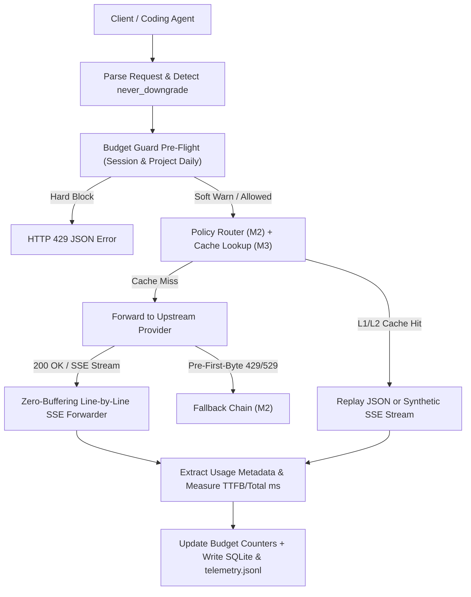

# ARCHITECTURE — Local LLM Router & Semantic Cache Proxy

## Overview
`Local-LLM-Router-Proxy` is a lightweight, single-binary Go reverse proxy that sits on `127.0.0.1:8787` between local coding agents/CLIs and upstream LLM providers:
1. **Gemini Native** (`/v1beta/models/{model}:generateContent` & `:streamGenerateContent?alt=sse`)
2. **OpenAI / Codex** (`/v1/chat/completions`, `/v1/responses`) & **Local Ollama** (`http://127.0.0.1:11434/v1`)
3. **Anthropic / Claude** (`/v1/messages`)

---

## Request Lifecycle

---

## Key Architectural Mechanics

### 1. Zero-Buffering SSE Streaming
- Upstream SSE responses are read line-by-line via `bufio.Reader.ReadBytes('\n')` (avoiding `bufio.Scanner`'s 64 KB token limit on large tool-call or thinking payloads).
- Each line is written immediately to `http.ResponseWriter` and flushed via `http.Flusher.Flush()` whenever a blank line (SSE event boundary) or `data:` line arrives, keeping added proxy latency sub-millisecond.
- Usage metadata (`usageMetadata` for Gemini, `usage` for OpenAI) is inspected on `data:` lines inline without buffering the full response body in memory.
- For OpenAI streaming requests, the proxy injects `"stream_options": {"include_usage": true}` if not already set so accurate token counts are always emitted in the final chunk.

### 2. Pre-First-Byte Fallback Invariant
- Once HTTP status `200` and the first SSE byte are flushed to the client, the stream is committed and cannot be transparently replayed to another provider.
- Therefore, fallback chains (`429`, `529`, `5xx`, or connect/first-byte timeout) execute **strictly before** any response bytes are written to the client.

### 3. Cache Invalidation & Opt-In Semantic Caching
- **L1 Exact Cache:** Keyed by SHA-256 of `(api_format, target_model, canonical_messages, tools, temperature, system_prompt)`. Only active for deterministic requests (`temperature == 0` or explicit `X-Router-Cache: force`). Streaming hits replay stored SSE frames.
- **L2 Semantic Cache:** Strictly **opt-in** per route (`semantic_cache: true`) or explicit header (`X-Router-Semantic-Cache: allow`), and disabled when tools are present. Code-generation and agentic debugging prompts often differ by a single variable name, line number, or compiler error; fuzzy matching those would return stale, corrupt code. L2 is reserved for mechanical tasks (summarization, classification, log trimming, commit messages).

### 4. Budget Guardrails & `never_downgrade`
- Budgets are tracked atomically in SQLite (`budget_usage`) across `session` (`X-Router-Session`, window `0`) and `project_daily` (`X-Router-Project`, UTC midnight window).
- Reaching `soft_warn_pct` (default `80%`) injects `X-Router-Budget-Warning` on the response without blocking.
- Exceeding `100%` triggers `hard_action`:
  - `"block"` returns HTTP `429`.
  - `"downgrade"` reroutes to `downgrade_target` (e.g., local Ollama) **unless** `never_downgrade` is true (`X-Router-Tier: frontier`, `thinkingConfig`, or `reasoning_effort`), in which case it **hard-blocks with `429`** rather than silently degrading reasoning quality.

### 5. `TokenHUD` Telemetry Contract
Every completed request writes:
1. A row to SQLite `requests_log` (WAL mode) for fast aggregation via `GET /metrics/summary`.
2. A single-line JSON object to `data/telemetry.jsonl` containing `id`, `ts_utc`, `project_id`, `session_id`, `api_format`, `requested_model`, `routed_provider`, `routed_model`, `cache_status`, `prompt_tokens`, `completion_tokens`, `cached_tokens`, `estimated_cost_usd`, `baseline_cost_usd`, `saved_cost_usd`, `saved_tokens`, `ttfb_ms`, `total_ms`, and `proxy_overhead_ms`.
